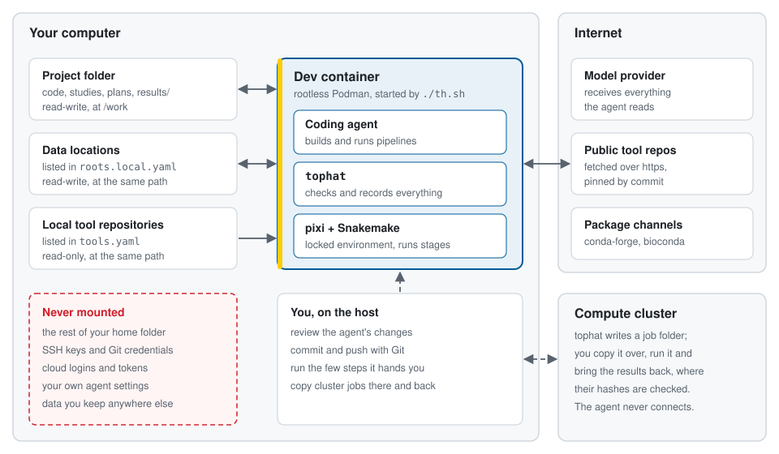

<p align="center">
  
</p>

<h1 align="center">TopHat</h1>

<p align="center">
  <strong>AI-assisted research where the scientist stays in charge, the agent does the legwork, and
  every result comes with its provenance.</strong>
</p>

---

TopHat sets up a research project in which you work with an AI coding agent, such as Claude Code.
You talk to the agent about what you want to find out; it writes and runs the analysis. TopHat
makes sure that you, not the agent, make the scientific decisions, and that every result can be
traced back to how it was made.

- **You make the scientific decisions.** You ask the questions, decide what will be measured and
  what result would count as an answer, and interpret what you find. The agent helps you think them
  through but never makes them for you.
- **The agent does the legwork.** It writes the pipelines, runs them and keeps the records that
  usually get skipped: which data, which code, which software versions.
- **The `tophat` tool checks the agent's work.** It checks mechanically, with no AI involved, that
  every reported result traces back to its question, to the plan you made before seeing any
  results, and to the exact code, environment and data that computed it.

Everything runs in a container that keeps the agent away from the rest of your computer. TopHat
works in any scientific field and any language your analysis needs (Python, R, Julia, shell, …).

> **Status: pre-release.** TopHat works end to end on its worked example, but no `tophat` binary
> has been released yet, and the study format may still change before 1.0. See
> [Getting started](#getting-started) for running it today.

## How it works

### A study, step by step

A TopHat project starts from your research questions. Each question is answered by one or more
**studies**, and every study follows the same path:

1. **Ask.** You and the agent write down the question in `PROJECT.md`.
2. **Explore.** You look at the data together in a scratch area, to learn what is worth measuring.
   Nothing from exploration can be reported as a result.
3. **Plan.** You decide the **primary endpoint** (the number that answers the question) and the
   **decision rule** (which values mean yes, no or no difference). The agent writes it all into the
   study's `STUDY.md`, together with checks the pipeline must pass.
4. **Pre-register.** You freeze the plan with one command, before any real result exists. Later
   changes are allowed but are recorded as dated amendments.
5. **Run.** The agent builds the pipeline and runs it. Where a step needs your judgment, such as
   whether an output looks right, the pipeline stops until you have looked.
6. **Report.** The result is filled in from the recorded outputs, the decision rule is applied as
   written, and you write the interpretation.

Here is the decision rule of the worked example that ships with every project:

> The median filter is better if the 95% bootstrap interval of the endpoint (2000 resamples of the
> signals, seed 1) lies entirely above 0. If the interval contains 0, the study shows no
> difference; if it lies entirely below 0, the mean filter is better.

### Who does what

| You, the scientist | The agent | The `tophat` tool |
|---|---|---|
| Ask the questions; choose the endpoint and decision rule | Helps you phrase them; never invents them | Gives each question a stable ID |
| Pre-register the plan | Writes the plan with you | Freezes it and records the date |
| Look at outputs and say whether they are fit to use | Shows you what to check | Stops the pipeline until you have |
| Run jobs on a compute cluster | Prepares the job and tells you the steps | Writes the job folder and verifies what comes back |
| Commit your work with Git | Tells you what to commit | Records which commit each result came from |
| Write the interpretation | Applies the decision rule you chose | Copies the result into the study |

### What keeps results trustworthy

- **Nothing runs twice, and nothing is overwritten.** Each pipeline step's output is stored under
  a fingerprint of its code, settings, inputs and software environment. Change anything that
  matters and it runs into a new folder; change nothing and it doesn't run again.
- **Data is never changed in place.** Datasets are registered with checksums, and studies share data
  only as named, versioned datasets, so you can always ask what a result was computed from.
- **Your own code stays separate.** Tools (your code or other people's) live in their own Git
  repositories and are pinned to an exact commit.
- **One check covers it all.** `tophat check` fails loudly on changes to a frozen plan, results from
  uncommitted code, out-of-date summaries, skipped quality checks, private data flowing into public
  studies, and more. The agent, a Git hook, CI and you all run the same check.

Pipelines run with [Snakemake](https://snakemake.github.io/) in a locked
[pixi](https://pixi.sh/) environment, but you never write Snakemake rules: the agent declares the
steps and writes ordinary scripts.

## Where it runs

<p align="center">
  
</p>

The agent works inside a rootless container, started with `./th.sh` from the project folder. The
container sees only what you give it:

- **The project folder**, with your code, studies, plans and (by default) the `results/` folder.
- **Data locations** you choose, such as a data disk or a shared drive. Tell the agent where your
  data is; it records the path in `.tophat/roots.local.yaml`, a file that stays on your machine
  and is never committed, so each computer can keep the data somewhere different.
- **Tools** your pipeline uses. A public Git repository is fetched over the internet. A repository
  on your own computer is mounted read-only, so nothing in the container can change it.

After adding a data location or a local tool, exit the container and run `./th.sh` again: the
container's folders are set when it starts.

### How safe is it?

Safe-ish. An AI agent can be misled by text it reads (prompt injection) or simply make mistakes,
so TopHat limits what it can reach rather than trusting it to behave.

What the container protects:

- **The rest of your computer.** The agent sees the project folder and the locations above, and
  nothing else from your home folder.
- **Your credentials.** No SSH keys, Git credentials, cloud credentials or your own agent settings
  enter the container. The agent logs in separately, and that login is stored apart from your own.
- **Your Git history and remotes.** The container has no Git identity and cannot commit. You review
  and commit on your computer, so nothing the agent writes reaches a result or a remote without
  passing you.
- **Your clusters.** The agent never connects to a remote machine, transfers data or submits jobs.
  It prepares a job folder and you run it.

What it does not protect:

- **Files the agent can see.** It can change or delete files in the project and in your data
  locations. Keep data backed up and commit often; `tophat check` flags data that no longer
  matches its checksums.
- **Data leaving over the network.** The container needs internet access for the agent and for
  installing packages, so a misled agent could send out what it can read.
- **Escapes from the container.** A rootless container is a strong barrier, not an absolute one.

### Keeping data confidential from the agent

Everything the agent reads (file contents, command output, error messages) is sent to the company
that runs its model. Whether that company keeps it or trains on it depends on your plan and its
terms, so check them before you start.

Data the agent never reads never leaves your computer through it. The container only sees the
project folder and your data locations, so to keep a dataset from the agent, keep it outside
both. TopHat does not yet automate working this way, which means:

- you run the steps that read the confidential data yourself, outside the agent session;
- you keep their outputs out of the project and the data locations too, since outputs of
  confidential data can be just as sensitive;
- you give the agent a synthetic or anonymized sample to build and test the pipeline against.

## Getting started

### What you need

- [Podman](https://podman.io/docs/installation) (or Apptainer on a cluster)
- [Copier](https://copier.readthedocs.io/) 9 or later, which creates the project
- A [Claude Code](https://claude.com/claude-code) account (the only supported agent so far)

### Create a project

```sh
copier copy gh:<owner>/tophat my-project
cd my-project
./th.sh       # builds and enters the container (the first build takes a few minutes)
claude        # start the agent inside the container
```

Copier asks for the project's name, description and author, any languages to install besides
Python, the default GPU setting, and a license for the project.

### Talk to the agent

From here on you mostly talk to the agent, in your own words. It knows the TopHat workflow and
runs the `tophat` commands itself. Some ways to begin:

- *"What should I do next?"* It looks at the project and suggests the next step. In Claude Code,
  `/th-next` does the same.
- *"Help me write the main question of this project."*
- *"My measurements are in /data/lab/2026-run. Register them."*
- *"I want to test whether method X beats docking on this benchmark. Let's plan a study."*
- *"Run the study."* or *"Why did the last run fail?"*
- *"How does a study work?"* It explains, using the guide in `.tophat/managed/GUIDE.md`.

The worked example study, `median-vs-mean`, shows a complete study from question to report. Ask the
agent to walk you through it.

### The steps you take yourself

A few steps are deliberately left to you, because they are your decisions or need your
credentials. When it is your turn, the agent stops and gives you the exact command.

| Step | Why it is yours | Where |
|---|---|---|
| Pre-register a study (`tophat study preregister`) | Freezing the plan is your commitment | in the container |
| Give a quality verdict (`tophat stage qc`) | Only you can judge if an output is fit to use | in the container |
| Fetch tool code (`tophat tools sync`) | You decide which code runs | in the container |
| Commit and push with Git | The container holds no Git identity or credentials | on your computer |
| Run cluster jobs | The agent never connects to remote machines | on the cluster |
| Write the study's interpretation | It is your reading of the result | in `STUDY.md` |

To run a command in the container while the agent is busy, open another terminal and run `./th.sh`
there.

### Your own agent skills

To have skills of your own (a writing style guide, say) in every TopHat project without adding them
to any project, put each in its own folder under `~/.config/tophat/skills/`, for example
`~/.config/tophat/skills/writing-clearly/SKILL.md`. `./th.sh` mounts them read-only into the
container's Claude Code. They are never committed, so your collaborators don't get them. A skill
with the same name as a project skill is skipped with a warning. Edits show up at once; adding or
removing a skill takes effect at the next `./th.sh`.

### Keeping a project up to date

```sh
copier update
```

Updates bring in new agent skills, checks and container fixes. They never overwrite your
`PROJECT.md`, studies, data, license or local skill extensions, and they never invalidate your
results or make finished studies re-run.

### Before the first release

Until the first release, the container needs a `tophat` binary you build yourself. Run
`cargo build --release` in this repository and point `TOPHAT_DEV_BINARY` at the result before
running `./th.sh`.

To create a project from a local checkout of this repository, give Copier its absolute path:
`copier copy /path/to/tophat my-project`. Copier stores the path in `.copier-answers.yml` exactly as
given, and `copier update` resolves it from the project folder, so a relative path like `tophat/`
breaks later updates. If that has already happened, set `_src_path` in `.copier-answers.yml` to
the absolute path and commit the change. To update from a local checkout, commit there first, then
run `copier update --vcs-ref HEAD` in the project.

## Why "TopHat"?

When you are awarded a doctorate in Sweden, the conferment ceremony crowns you with a top hat. It
marks the moment the academic community trusts your research: you have shown, in public, that you
can ask a question, answer it honestly and defend how you got there.

TopHat is about that kind of trust. An AI agent can now write a pipeline in minutes, which makes it
easier than ever to produce results, and harder to tell which of them deserve belief. The hat
stays with the scientist: your domain expertise decides what is asked and what counts as an answer.
The agent takes on the tedious parts, including the record-keeping that usually gets skipped, under
rules it cannot quietly break.

## What TopHat is not

- A workflow engine or job scheduler. Snakemake runs pipelines; you run cluster jobs.
- A data store. Your data stays where it is; TopHat records and verifies its checksums.
- An AI model. Your coding agent is the AI; TopHat gives it structure and rules.
- A domain library, electronic lab notebook or LIMS.

## Related work

TopHat builds on ideas from [riprap](https://github.com/MolSSI/riprap) (agent skills that turn intent into
written, reviewable requirements before code is written), applied to research instead of software.

## Developing TopHat

This repository contains the Copier template (`template/`), the `tophat` CLI (`src/`, Rust) and
development tooling (`xtask/`). The design is in [`rqm/ARCHITECTURE.md`](rqm/ARCHITECTURE.md), and
every behaviour is specified as a requirements file with Gherkin scenarios under [`rqm/`](rqm/).

TopHat is itself developed with riprap: all development, including the agent, happens inside a
dev container.

```sh
bash rr.sh        # Linux/macOS; rr.bat on Windows. Builds and enters the container.
cargo test        # inside the container
```

The workflow is requirements first. Change or add the requirements file under `rqm/`, then
implement it, and keep code and requirements in step. The `rr-plan` and `rr-implement` skills
guide the agent through this. A few rules:

- **Only run the agent inside the rootless container.** Never give it private keys, write access to
  remote repositories, or unreviewed pushes.
- **Keep credentials out of Git.** Install the pre-commit scanner with
  `bash rr.sh --install-git-hooks`.
- **Don't edit managed files.** Files under `.riprap/managed/` belong to riprap; project
  customization goes in `.riprap/user/`.

On a compute cluster without Podman, build an Apptainer image elsewhere with
`bash rr.sh --export-sif`, copy the repository over, and run `bash rr.sh --run-sif`.

## License

The `tophat` tool is under the BSD 3-Clause license. See [LICENSE](LICENSE).

The template files that Copier copies into a new project (everything under `template/`) are under
MIT No Attribution. See [template/TEMPLATE-LICENSE](template/TEMPLATE-LICENSE). A generated project
needs no notice from TopHat. When you create a project, Copier asks which license it should use
(MIT, BSD-3-Clause, Apache-2.0, GPL-3.0-or-later, or none) and writes the matching `LICENSE` file.

The development setup of this repository comes from [riprap](https://github.com/MolSSI/riprap)
under the MIT License. See [LICENSE-riprap](LICENSE-riprap). It covers the riprap-managed files:
everything under `.riprap/managed/` and the paths listed in `.riprap/managed/ownership-exceptions`
(including `rr.sh`, `rr.bat` and the agent skill folders).
